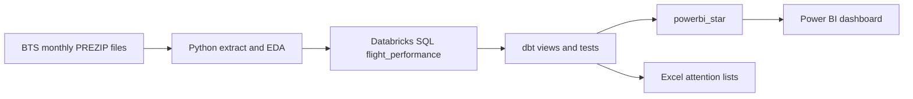

# JetBlue Domestic Operational Disruption and Attention Priorities

JetBlue’s domestic operational disruption is concentrated across specific airports, routes, and time periods. This project locates that concentration in public BTS on-time data, keeps arrival delays, cancellations, diversions, and reported delay causes as separate measures, and turns the ranking into a first-pass attention list for limited operational review.

**Central question:** Where is JetBlue’s domestic operational risk concentrated, what is associated with it, and where should limited operational attention go first?

**Management principle:** Distinguish accumulated operational impact (arrival-delay minutes on busy places) from elevated reliability rates. Do not collapse these into one disruption score. A high rate on a thin place is a monitoring item, not the first place to look.

**Window:** JetBlue (`Reporting_Airline` = `B6`), domestic only, 1 January 2018 through 31 July 2026. Deliverables: tested dbt models, a Power BI star-schema dashboard, an Excel attention-list workbook, and a written decision memo.

Full decision argument: [`Documentation/EXECUTIVE_DECISION_MEMO.md`](Documentation/EXECUTIVE_DECISION_MEMO.md).

| Milestone | Date |
| --- | --- |
| Data audit (`DATA_AUDIT.md`) | 8 October 2026 |
| Findings reconciled (`FINDINGS.md`) | 2 November 2026 |
| Executive memo, workbook, and dashboard documentation | 8 November 2026 |
| Latest documented dbt validation (`dbt build`, 13 views / 40 tests) | 16 November 2026 |

---

## Business problem and objectives

Domestic means the 50 states, the District of Columbia, Puerto Rico, and the U.S. Virgin Islands. A late arrival is 15 minutes or more on an operated flight. An operated flight is not cancelled and not diverted.

### Objectives

- Identify where arrival-delay minutes accumulate.
- Distinguish operational volume from reliability rates.
- Flag airport and directed-route priorities with volume floors (no weighted score).
- Investigate weekday and monthly patterns, with 2020 labeled.
- Keep arrival delays, cancellations, and diversions separate.
- Translate findings into five actionable operational reviews.

Ranking only by late-arrival percentage is misleading: the five highest rates cover **0.17%** of arrival-delay minutes, while the five highest-minute origins cover **49.9%**.

---

## Executive summary

| KPI | Value |
| --- | ---: |
| Scheduled flights | **2,110,783** |
| Operated flights | **2,052,821** |
| Late-arrival rate | **26.9%** of operated flights |
| Cancellation rate | **2.40%** of scheduled flights |
| Diversion rate | **0.345%** diverted and not cancelled |
| Arrival-delay minutes | **44,184,241** |
| Scope | **91** airports · **718** directed routes · **103** months |

Five origins — JFK, Boston, Fort Lauderdale, Orlando, and San Juan — account for **22,045,754** minutes (**49.9%**). Boston flies more than JFK and arrives late less often (**25.4%** vs **27.8%**); JFK still has more minutes. On late arrivals, carrier + late-aircraft delay is **76.4%** of recorded cause minutes—a reporting association, not proof those minutes were avoidable, and not a cost.

---

## Key findings

Source: [`Documentation/FINDINGS.md`](Documentation/FINDINGS.md). Descriptive associations only—not causal estimates.

### A. Network performance

**2,110,783** scheduled flights; **2,052,821** operated; **551,753** late arrivals (**26.9%**); **50,674** cancellations (**2.40%**); **7,288** diversions not cancelled (**0.345%**); **44,184,241** arrival-delay minutes on operated flights.

Keep the three event types separate when reviewing any airport, route, or period.

### B. Airport concentration

| Origin | Flights | Late-arrival rate | Minutes |
| --- | ---: | ---: | ---: |
| JFK | 317,477 | 27.8% | 6,516,458 |
| Boston | 350,117 | 25.4% | 6,312,537 |
| Fort Lauderdale | 170,468 | 30.0% | 3,778,579 |
| Orlando | 144,635 | 30.2% | 3,508,770 |
| San Juan | 82,442 | 28.8% | 1,929,410 |

These five are **50.5%** of flights and **48.4%** of cancellations. Fort Lauderdale and Orlando combine a ~30% late rate with a large base. In 2022–2025, LaGuardia replaces San Juan as fifth by minutes; that check does not change the first review.

### C. Directed routes

| Route | Flights | Late-arrival rate | Minutes |
| --- | ---: | ---: | ---: |
| MCO → JFK | 22,110 | 31.8% | 612,862 |
| DCA → BOS | 28,525 | 23.6% | 576,647 |
| MCO → EWR | 14,407 | 35.9% | 434,041 |
| FLL → EWR | 10,993 | 35.8% | 299,164 |

MCO → JFK leads by minutes. Boston–Washington carries a similar minute load at rates in the low 20s because it flies more. MCO → EWR and FLL → EWR are the sharp high-rate cases with a real base. Directions are separate.

**Seasonal note:** July is strongest network-wide and first for these three Florida–New York routes *taken together*; August is second for that combined view. That does **not** make July the best review month for every individual route—see recommendation 2.

### D. Day of week

Sunday leads on late rate (**29.5%**), cancellation rate (**2.88%**), and minutes (**7.37M**). Friday is busiest (**314,540** flights, **28.6%** late). Wednesday is most reliable (**23.5%** late). The Sunday gap is seasonal (**7.4** points in January; **0.9** in July; August Sunday is slightly better than other days). A Sunday review does not explain July.

### E. Monthly seasonality

July is heaviest (**33.6%** late, **5,754,997** minutes; **34.9%** with 2020 removed). August and December both round to **32.0%** late; August has more minutes. October is lightest (**21.1%** late).

### F. Disruption causes

Late-arrival cause minutes: late aircraft **39.2%**, carrier **37.2%**, NAS **20.7%**, weather **2.7%**, security **0.2%**. Cancellation codes: weather **36.1%**, carrier **28.6%**, NAS **22.0%**, security **13.3%** (almost entirely 2020). Weather delay is the extreme-weather bucket, not every weather minute inside NAS.

### G. Reliability vs volume

Volume floors: origins ≥1,000 flights; routes ≥500. Cutoffs (2 Nov 2026 build): origins **29.59%** late / **3.06%** cancelled. Miami: **34.3%** late on **13,280** flights, minute rank 22. LaGuardia: **3.32%** cancelled, only top-10 minute airport above the cancellation cutoff. Rate-only top five covers **0.17%** of minutes.

---

## Operational recommendations

Places to investigate—not claims that one change will cut delay, and not dollar savings.

### 1. Review JFK and Boston first

| | |
| --- | --- |
| **Evidence** | **12.8M** minutes together (**29%** of **44.2M**). JFK: **317,477** flights, **27.8%** late. Boston: **350,117** flights, **25.4%** late. Boston flies more and is late less often; JFK still has more minutes. |
| **Investigate** | Whether turns and late aircraft explain the gap. Late-flight cause mix is **39.2%** late aircraft / **37.2%** carrier—not proof of avoidability. |
| **Decision** | Whether hub turn and late-aircraft recovery at JFK and Boston warrant deeper review before other stations. |

### 2. Review Florida–New York routes (MCO → JFK, MCO → EWR, FLL → EWR)

| | |
| --- | --- |
| **Evidence** | MCO → JFK: **22,110** flights, **31.8%** late, **612,862** minutes. MCO → EWR: **14,407**, **35.9%**, **434,041**. FLL → EWR: **10,993**, **35.8%**, **299,164**. |
| **Combined seasonality** | July is strongest network-wide and first for these three routes *together*; August is second for that combined view. Leave December off the first list (June has more combined minutes than December). |
| **Route-specific caveat** | July is **not** automatically the best review month for every individual route. For **FLL → EWR**, April has more arrival-delay minutes than July; July has the higher late-arrival rate. Set each route’s review window from its own monthly minute and rate pattern. |
| **Decision** | Whether Florida–New York schedule and recovery practices need a focused, route-aware review. |

### 3. Review Sunday, then Friday

| | |
| --- | --- |
| **Evidence** | Sunday: **312,745** flights, **29.5%** late, **7.37M** minutes. Friday: **314,540** flights, **28.6%** late, **6.95M** minutes. Sunday gap: **7.4** pts in January, **0.9** in July. |
| **Investigate** | Pair Sunday with the winter operation. This review does not explain July. |
| **Decision** | Whether weekend staffing, turn buffers, or recovery plans need separate winter vs summer treatment. |

### 4. Review Miami for late arrivals

| | |
| --- | --- |
| **Evidence** | **34.3%** late on **13,280** flights; minute rank **22**. |
| **Investigate** | Reliability review, not a minute review. |
| **Decision** | Whether Miami’s late-arrival rate justifies a station reliability deep dive despite lower minute rank. |

### 5. Review LaGuardia for cancellations

| | |
| --- | --- |
| **Evidence** | **2,168** of **65,340** flights cancelled (**3.32%**). Only top-10 minute airport above the **3.06%** cancellation cutoff. |
| **Investigate** | Treat cancellation elevation separately from late-arrival elevation. Fort Myers is next among large airports on that list. |
| **Decision** | Whether LaGuardia needs a dedicated cancellation review. |

Leave 2020 security-coded cancellations and places under 250 flights out of the first pass.

---

## Power BI vs Excel

| Deliverable | Purpose |
| --- | --- |
| **Power BI** (`Jetblue_Final_analysis.pbix`) | Interactive exploration of network KPIs, the three event types, minutes, rate-vs-size, calendar patterns, and the five attention reviews—on a star schema. |
| **Excel** (`Jetblue_sensitivity_analysis.xlsx`) | Compares alternative *attention lists* and how much of the network each list covers. Not rebuilt in the dashboard. No forecast and no savings estimate. |

---

## Power BI dashboard

Reads `jetblue_capstone.powerbi_star` (`Fact_Flight`, `Dim_Month`, `Dim_Weekday`, `Dim_Origin`, `Dim_Route`). Rates are measures on the fact (late ÷ operated; cancelled ÷ flights). Priority flags sit on dimensions; counts stay on the fact. Screenshots in [`Reports/`](Reports/) show the full window, including 2020.

### 1. Overview


Network volume and reliability KPIs, high-impact origin minutes, flights by year. Opens the JFK/Boston minute conversation.

### 2. Three Events


Late arrivals, cancellations, and diversions as separate counts by busy origins and by month.

### 3. Minutes


Arrival-delay minutes by origin and directed route, with a year slicer.

### 4. Rate and Size


Late-arrival rate beside flight volume (≥1,000 flights), plus elevated-cancellation origins.

### 5. Patterns


Weekday volume and minutes, late arrivals by month, and cause-minute buckets (carrier, late aircraft, security, weather, NAS).

### 6. Attention


The five reviews: JFK and Boston; Florida–New York routes (with route-aware months); Sunday then Friday; Miami late arrivals; LaGuardia cancellations—plus monitoring and elevated-flag charts.

---

## Excel attention-prioritization model

Four sheets: **Raw Data** (91 origins), **Airports** (minutes and rate ranks), **Scenario** (five list rules via dropdown), **Scorecard** (plan vs rate-only list).

| List of five | Minutes covered | Share |
| --- | ---: | ---: |
| First five by minutes (plan) | 22,045,754 | 49.9% |
| Five highest late-arrival rates | 75,342 | 0.17% |

Also available: first ten by minutes (**65.4%** of minutes), top five by cancellations, and minutes-plus-largest-cancellation-airport-left-off. Coverage counts only—not measured savings.

---

## Technical architecture



| Tool | Role |
| --- | --- |
| **Python** | Extract `B6` from monthly zips; quality checks and exploratory tables. |
| **Databricks** | Catalog `jetblue_capstone`; flight-level store and dbt schemas. |
| **SQL** | Maps BTS columns into `views.flight_performance`. |
| **dbt** | 8 analytical views in `dbt_dev` + 5 star-schema views in `powerbi_star`; locked tests. |
| **Excel** | Attention-list coverage comparison. |
| **Power BI** | Interactive dashboard on the star schema. |

Documented validation: `dbt build` on **16 November 2026** passed **13 views** and **40 tests**. Copies in the `views` schema are not the dbt build.

**Analytical views (`dbt_dev`):** `monthly_performance`, `airport_month`, `route_month`, `delay_causes`, `weekday_performance`, `cancellation_reason`, `origin_priority`, `route_priority`.

**Star (`powerbi_star`):** `fact_flight`, `dim_month`, `dim_weekday`, `dim_origin`, `dim_route`.

---

## Analytical methodology

Rules in [`Documentation/METHODOLOGY.md`](Documentation/METHODOLOGY.md).

| Topic | Rule |
| --- | --- |
| Geography | Domestic only |
| Late arrival | `ArrDel15` = 1 on operated flights |
| Late-arrival denominator | Operated = not cancelled and not diverted (**2,052,821**) |
| Cancellation denominator | All scheduled flights |
| Diversions | Diverted and not cancelled; separate from cancellations and late arrivals |
| Volume floors | Origins ≥1,000; routes ≥500; monitoring 250+ with elevated rate |
| Priority | Flags only (high accumulated impact; elevated late/cancel; monitoring)—no weighted score |
| 2020 / 2026 | 2020 labeled in pooled rates; 2026 is Jan–Jul only and not annualized |

Minutes and rates are evaluated separately: minutes capture load; rates capture reliability.

---

## Data sources and limitations

**Source:** BTS Reporting Carrier On-Time Performance (1987–present), TranStats `gnoyr_VQ=FGJ`, monthly PREZIP files, `Reporting_Airline` = `B6`. Raw files stay local (not committed).

**Not in the file:** passengers, fares/revenue, crew, maintenance, independent weather.

The analysis is **descriptive, not predictive**. Associations are not causation. Carrier and late-aircraft categories do not prove avoidable delay. No financial savings are established. 2020 is an unusual period; 2026 is a partial year and may include marketed codeshares that cannot be split out. Public BTS reports are not JetBlue’s internal operations database.

---

## Repository structure

```text
src/                 Python extract and EDA
sql/                 Flight-level Databricks view mapping
models/              dbt analytical views + powerbi_star
tests/               Singular tests locking audit/findings counts
Documentation/       Audit, dictionary, methodology, findings, memo
Reports/             Power BI page screenshots
Jetblue_Final_analysis.pbix
Jetblue_sensitivity_analysis.xlsx
data/raw/            Local BTS files (gitignored)
```

---

## Skills demonstrated

**Analytics:** EDA; operational performance; reliability vs volume; reported cause investigation; investigation-priority recommendations.

**Engineering:** Python extraction; SQL transforms; Databricks; dbt modeling/testing (13 views; documented 40-test build); relational grains and priority flags.

**BI:** Power BI; star schema; KPI design; interactive dashboards; Excel attention-list modeling; management decision support.

---

## Documentation index

| Document | Contents |
| --- | --- |
| [`Documentation/BUSINESS_PROBLEM.md`](Documentation/BUSINESS_PROBLEM.md) | Question, scope, claim limits |
| [`Documentation/DATA_AUDIT.md`](Documentation/DATA_AUDIT.md) | Measured file review (8 Oct 2026) |
| [`Documentation/DATA_DICTIONARY.md`](Documentation/DATA_DICTIONARY.md) | Verified fields |
| [`Documentation/METHODOLOGY.md`](Documentation/METHODOLOGY.md) | KPI rules, grains, priority framework |
| [`Documentation/FINDINGS.md`](Documentation/FINDINGS.md) | Reconciled rankings (2 Nov 2026) |
| [`Documentation/EXECUTIVE_DECISION_MEMO.md`](Documentation/EXECUTIVE_DECISION_MEMO.md) | Decision memo (8 Nov 2026) |
