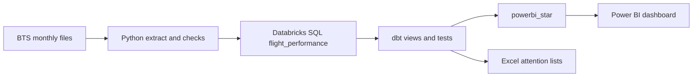

# JetBlue Operational Performance and Strategic Risk Analytics

Graduate capstone for the MS in Business Analytics at Hofstra University.

Public Bureau of Transportation Statistics on-time data for JetBlue (`Reporting_Airline` = `B6`). This is not proprietary JetBlue operational data. No peer airline and no machine-learning model.

## Business problem

Where is JetBlue’s domestic operational risk concentrated, what is associated with it, and where should limited operational attention go first?

Domestic means the 50 states, the District of Columbia, Puerto Rico, and the U.S. Virgin Islands. Mexico and the rest of the Caribbean are out of scope. Cancellations, diversions, and arrival delays stay separate. A late arrival is 15 minutes or more on an operated flight. An operated flight is not cancelled and not diverted.

## Executive summary

From January 2018 through July 2026, JetBlue reported 2,110,783 domestic flights. 26.9% of operated flights arrived late, and 2.40% of scheduled flights were cancelled.

Half of arrival-delay minutes sit at five origins: JFK, Boston, Fort Lauderdale, Orlando, and San Juan. Boston flies more than JFK and has a better late-arrival rate. JFK still has more minutes. Fort Lauderdale and Orlando combine a rate near 30% with a large base. Miami is the main reliability watch item that is not in the top 10 by minutes: 13,280 flights and a 34.3% late-arrival rate.

Sunday is the worst day. Friday is the busiest. July is the heaviest month. Both still lead with 2020 removed. On flights that were already late, carrier delay plus late-aircraft delay is 76.4% of recorded cause minutes. That split is a reporting association on flights that were already late.

The full argument is in `Documentation/EXECUTIVE_DECISION_MEMO.md` and `Documentation/FINDINGS.md`.

## Key findings

- Top origins by arrival-delay minutes: JFK 6.52 million, Boston 6.31 million, Fort Lauderdale 3.78 million, Orlando 3.51 million, San Juan 1.93 million.
- Largest directed route by minutes: MCO → JFK, 612,862 minutes, 31.8% late. Boston–Washington carries a similar load at a rate in the low 20s.
- High rate with a real route base: MCO → EWR 35.9% on 14,407 flights, FLL → EWR 35.8% on 10,993 flights.
- Sunday: 29.5% late, 2.88% cancelled, 7.37 million minutes. Wednesday: 23.5% late.
- Cancellation codes: weather 36.1%, carrier 28.6%, NAS 22.0%, security 13.3%. Almost all security-coded cancellations are March–April 2020.
- The attention list is the first five origins by arrival-delay minutes: JFK, Boston, Fort Lauderdale, Orlando, and San Juan. They cover 22,045,754 minutes (49.9%) and 1,065,139 flights (50.5%). The five highest late-arrival rates cover 75,342 minutes (0.17%).

## Technology stack

Each tool has one job. The analysis is complete.

| Tool | Job |
| --- | --- |
| Python `src/filter_jetblue.py` | Read the monthly BTS zips, keep `Reporting_Airline` = `B6`, write `data/raw/jetblue_b6.csv`. |
| Python `src/jetblue_eda.py` | Check the extract and produce the exploratory tables that `FINDINGS.md` was reconciled against. |
| Databricks `jetblue_capstone.views.flight_performance` | Flight-level store the models read. |
| dbt `jetblue_capstone.dbt_dev` | One tested view per analytical grain, including the priority flags. |
| dbt `jetblue_capstone.powerbi_star` | Flight fact and the dimensions the dashboard uses. |
| Excel `Jetblue_sensitivity_analysis.xlsx` | Compare attention lists on the origin extract. |
| Power BI `Jetblue_Final_analysis.pbix` | The finished dashboard. |

## Data source

Bureau of Transportation Statistics Reporting Carrier On-Time Performance (1987–present), TranStats table parameter `gnoyr_VQ=FGJ`. Monthly PREZIP files, January 2018 through July 2026, kept where `Reporting_Airline` is `B6`. 103 months, 91 airports, 718 directed routes. The raw files stay local.

## Project architecture



`jetblue_capstone.views.flight_performance` is the flight-level source the models read. dbt writes the analytical views to `jetblue_capstone.dbt_dev` and the dashboard model to `jetblue_capstone.powerbi_star`. Copies of some views also exist in the `views` schema. Those copies are not what dbt builds.

## Analytical methodology

Operated flights are the late-arrival denominator. All scheduled flights are the cancellation denominator. Blank delay fields stay blank. Controllable minutes are `CarrierDelay` plus `LateAircraftDelay`, and only on late arrivals. `WeatherDelay` is not every weather minute inside NAS.

Origins need at least 1,000 flights to enter the main ranking. Directed routes need at least 500. JFK → FLL and FLL → JFK are different routes. Origin and destination roles stay separate.

2020 is labeled wherever a rate is pooled. 2026 is January–July only. The rules are in `Documentation/METHODOLOGY.md`.

## Attention lists

`Jetblue_sensitivity_analysis.xlsx` reads the origin ranking and compares lists.

- `Raw Data` is the origin extract: one row per origin, with flights, rates, minutes, and the priority flags.
- `Airports` looks up that extract and ranks each origin by arrival-delay minutes and by late-arrival rate.
- `Scenario` compares five ways to choose a list. The plan is the first five origins by minutes.
- `Scorecard` puts that minutes list beside the five highest late-arrival rates.

On the current workbook the first five cover 22,045,754 minutes (49.9%), 1,065,139 flights (50.5%), and 24,551 cancellations (48.4%). The five highest late-arrival rates cover 75,342 minutes (0.17%) on 2,340 flights. That rate list has no volume floor, so it includes airports `origin_priority` leaves off. Newark is the largest minute airport left off the five. LaGuardia is the cancellation airport left off the five. There is no dollar conversion.

## Operational prioritization

`origin_priority` and `route_priority` assign flags. They do not compute a weighted score.

- **High accumulated impact:** the 10 volume-qualified origins, and the 10 volume-qualified routes, with the most arrival-delay minutes.
- **Elevated reliability:** the same volume floors, and a late-arrival rate or a cancellation rate at or above the 75th percentile of that set. The two rates are separate flags.
- **Monitoring:** 250–999 flights for origins, and 250–499 for routes, with a late-arrival rate at or above that same percentile.

On the current build the origin cutoffs are 29.59% late and 3.06% cancelled. The route cutoffs are 30.95% late and 2.83% cancelled.

## Project structure

```text
src/filter_jetblue.py          Keep B6 from the monthly zips
src/jetblue_eda.py             Quality checks and the exploratory tables
models/                        dbt analytical views and the Power BI star
tests/                         dbt tests, including the locked counts
Jetblue_sensitivity_analysis.xlsx          Attention-list comparison
Jetblue_Final_analysis.pbix    Finished dashboard
Documentation/                 Audit, dictionary, methodology, findings, memo
data/raw/                      Local BTS files. Not in git
```

Views in `dbt_dev`: `monthly_performance`, `airport_month`, `route_month`, `delay_causes`, `weekday_performance`, `cancellation_reason`, `origin_priority`, `route_priority`.

Views in `powerbi_star`: `fact_flight`, `dim_month`, `dim_weekday`, `dim_origin`, `dim_route`. The dimensions carry keys and the priority flags. Flight counts stay on `fact_flight`.

## Reproduce the analysis

1. Put the official monthly zips in `data/raw/`.
2. Run `python src/filter_jetblue.py`, then `python src/jetblue_eda.py`. The script expects the local Windows paths at the top of each file. It rewrites `data/raw/jetblue_b6_clean.csv` only after the audit checks pass.
3. Load the flight-level table behind `jetblue_capstone.views.flight_performance`. That load is already done in this workspace.
4. From this folder, with the dbt profile `jetblue`, run `dbt build`. Analytical views land in `dbt_dev`. The star lands in `powerbi_star`.
5. `Raw Data` in the workbook is the origin extract. `Airports`, `Scenario`, and `Scorecard` read that sheet.

`dbt build` on 8 November 2026 passed 13 views and 37 tests: the 8 analytical views in `dbt_dev` and the 5 dashboard views in `powerbi_star`. July 2023, the origin ranking, and MCO → JFK still match `FINDINGS.md`.

## Limitations

No passengers, fares, crew, maintenance, or independent weather. No causal claim and no dollar saving. 2020 is not a normal year. 2026 cannot be split into operated and marketed codeshare flights and cannot be annualized. Blank cause minutes are not zeros. The workbook compares lists. It does not estimate the effect of a program.

## Dashboard

`Jetblue_Final_analysis.pbix` is the finished report. It reads `jetblue_capstone.powerbi_star` (`Fact_Flight`, `Dim_Month`, `Dim_Weekday`, `Dim_Origin`, `Dim_Route`) and uses `origin_priority` on the Overview and Attention pages. Rates are measures on the flight fact: summed late arrivals divided by summed operated flights, and summed cancellations divided by summed flights. `delay_causes` stays in `dbt_dev` as the cause-minute check. The report does not use it.

| Page | What it shows |
| --- | --- |
| Overview | Flights, late-arrival rate, cancellation rate, diversion rate, and the high-impact origins. |
| Three Events | Late arrivals, cancellations, and diversions kept separate, including the ten busiest origins. |
| Minutes | Arrival-delay minutes by origin and by directed route. |
| Rate and Size | Late-arrival rate beside flight volume, and the elevated cancellation flag. |
| Patterns | Weekday, month, and the five delay-cause buckets. |
| Attention | High accumulated impact, monitoring origins, and elevated late-arrival routes. |

The attention-list comparison stays in the workbook. The report does not rebuild it.
